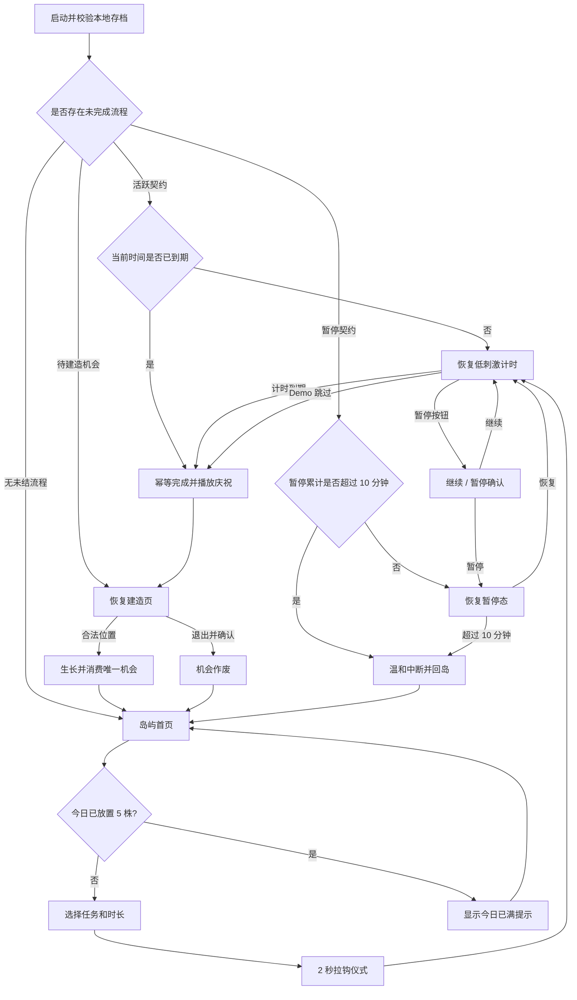

# 《拉钩岛》阶段 1：需求分析与开发规划

> 文档状态：阶段 1 产品与美术基线已确认；待明确授权进入可玩原型制作  
> 编制日期：2026-11-20  
> 本阶段边界：只做需求、架构、资源和测试规划，不进入大规模开发。  
> 技术基线：Phaser + TypeScript + Vite，纯前端，`localStorage`，手机触控与电脑鼠标，支持独立静态部署。

## 1. 结论摘要

首个可玩版本应只围绕一条闭环构建：

`空岛/已有岛屿 → 选任务和时长 → 拉钩 → 低刺激计时 → 庆祝 → 放置 1 株 → 回岛查看铭牌`

在这条闭环稳定后，再连续完成 5 次放置，验证：

`今日 5/5 → 再次点击“拉钩” → 今日已满的温和提示 → 不创建新契约`

2026-11-20 产品回复确认后的五条产品不变量（覆盖初版的“三株/第四次勋章”规则）：

1. **一约一放**：一个已完成契约最多生成一个建造机会，且最多对应一个岛屿物品。
2. **低刺激计时**：默认无数字倒计时；儿童正式界面中只允许色盘线性消退和小伴龙呼吸。Demo 工具模式例外显示右上角“跳过计时”，正式构建必须屏蔽。
3. **每日最多建造 5 株**：以本地自然日和实际成功放置数计数，不按契约创建数计数。
4. **Demo 移除勋章**：达到 5/5 后再次点击“拉钩”只显示温和的今日已满提示，不创建新契约，也不发放勋章。
5. **演示工具可隔离**：保留 `?fast=1`，并提供仅 Demo 构建可见的“跳过计时”和昼/夜切换；正式构建通过编译配置完全移除这些控件。

## 2. 需求来源与裁决顺序

本规划读取并交叉核对了以下文档：

1. 《拉钩岛 PRD》V0.9-Demo；
2. 《拉钩岛美术素材清单与视觉规范》V1.0；
3. 《拉钩岛昼夜系统技术规格书》。

遇到冲突时暂按以下优先级编排，最终以产品确认结果为准：

1. 本次任务中明确指定的技术与产品原则；
2. PRD 的核心玩法、P0 范围和验收条件；
3. 较新的 V1.0 美术规范；
4. 昼夜系统规格中的通用算法和视觉意图。

因此：项目使用 Phaser，不使用 PRD 建议的纯 DOM/SVG 方案，也不使用昼夜规格中的 Cocos 实现。Demo 提供 Phaser 实现的昼/夜两态测试开关；连续时段、完整粒子与品质分档仍不进入首发范围。

## 3. 功能优先级

### 3.1 P0：最小可玩的完整链路

| 编号 | 能力 | P0 交付边界 |
| --- | --- | --- |
| P0-01 | 启动与恢复 | 首次初始化、存档校验、资源预载、异常存档回退为空岛 |
| P0-02 | 岛屿首页 | 单主岛、二维分层 + 轻量伪 2.5D 场景、角色待机、已放物品、今日 `n/5`、新手引导、拉钩入口 |
| P0-03 | 任务选择 | 8 个预设任务、5/10/15/20 分钟单选、未完成选择时禁用确认 |
| P0-04 | 拉钩仪式 | 2 秒不可跳过动画与确认音，结束后创建并启动契约 |
| P0-05 | 低刺激计时 | 色盘、任务名、不可点击的陪伴角色、唯一暂停按钮、前后台时间校正 |
| P0-06 | 暂停/中断 | 确认面板、暂停冻结、恢复、暂停累计超过 10 分钟自动中断且无惩罚文案 |
| P0-07 | 断点恢复 | 活跃计时恢复；离线期间已到时则幂等完成；暂停超时则幂等中断 |
| P0-08 | 完成庆祝 | 3 秒动画与音效，随后产生唯一的待放置机会 |
| P0-09 | 岛屿建造 | 素材选择、指针/触控拖放、32×32 网格吸附、合法性与重叠判断、生长动画 |
| P0-10 | 一约一放 | 建造机会只能成功消费一次；退出建造二次确认后机会作废，不影响已完成契约 |
| P0-11 | 铭牌 | 物品常态不显示文字；点击弹跳后显示日期、任务、约定时长。虽 F8 标为 P1，但 F5 和 P0 验收已要求，故执行上纳入 P0 |
| P0-12 | 每日饱和 | 成功放置后计数；同一自然日最多 5 株；达到上限后不再创建契约 |
| P0-13 | 今日已满提示 | 5/5 后点击拉钩显示温和提示；Demo 不实现勋章相关状态、动画与音效 |
| P0-14 | 演示模式 | `?fast=1`、右上角“跳过计时”、昼/夜切换；演示工具不能绕过 5 株上限，正式构建必须移除 |
| P0-15 | 输入与适配 | 812×375 横屏逻辑画布，手机安全区，触控/鼠标统一 Pointer 输入，竖屏显示旋转提示 |
| P0-16 | 合规与性能 | 无外部数据上传、无账号/付费；资源按需加载、压缩复用和浏览器缓存；中低端手机目标 ≥30fps；不得为减小体积明显降低已批准美术品质 |
| P0-B | 精简家长周报 | 家长门、本周专注分钟、完成数/完成率、任务分布；不含岛屿前后对比和分享卡 |

> 产品已确认新增 P0-B 精简周报，用于满足竞标验收；完整视觉包装和本地分享卡继续留在 P1。

### 3.2 P1：增强成长叙事与家长价值

| 编号 | 能力 | 交付边界 |
| --- | --- | --- |
| P1-01 | 素材解锁 | 累计完成契约的约定分钟数达到 30/60 分钟时解锁 b2/b3；`fast=1` 仍按约定分钟累计 |
| P1-02 | 完整素材批次 | 补齐 b2、b3 各自未纳入 P0 的 4 款素材及三件套 |
| P1-03 | 家长门 | 两位数加法题；答对进入周报；无账号、无真实身份校验 |
| P1-04 | 家长周报增强 | 在 P0-B 指标基础上补充完整视觉包装；产品已取消岛屿前后对比 |
| P1-05 | 本地分享卡 | 由 Phaser 画布快照生成图片，仅在设备本地保存，不上传 |
| P1-06 | 音效完善 | 解锁音与通用按钮音；计时与暂停等待始终静音 |

### 3.3 P2：非阻塞体验增强

| 编号 | 能力 | 交付边界 |
| --- | --- | --- |
| P2-01 | 专注之旅 | 5→10→15→20 分钟四级展示和下一里程碑文案 |
| P2-02 | 48 小时回归 | 根据最后访问时间显示一次“想念你的花”欢迎动画 |

### 3.4 PRD 功能追踪矩阵

| PRD ID | 原优先级 | 规划优先级 | 结论 |
| --- | --- | --- | --- |
| F1 任务选择 | P0 | P0 | 原样保留 |
| F2 拉钩立约 | P0 | P0 | 原样保留，契约在仪式结束时生效 |
| F3 低刺激计时 | P0 | P0 | 原样保留，作为最高级体验红线 |
| F4 契约状态确认 | P0 | P0 | 原样保留；“一次性”的精确定义待确认 |
| F5 岛屿建造 | P0 | P0 | 原样保留，补充唯一奖励与原子落盘约束 |
| F6 每日饱和与独立勋章 | P0 | P0（已改写） | 产品决定改为每日 5 株，Demo 移除勋章，达到上限只显示温和提示 |
| F7 累计与解锁 | P1 | P1 | 原样保留；P0 只预留配置和数据字段 |
| F8 铭牌查看 | P1 | **P0** | F5 描述和 P0 验收第 6 条已强制要求，故上调 |
| F9 家长周报 | P1 | P0-B + P1 | P0-B 实现精简数据版；P1 补视觉包装和本地分享卡 |
| F10 专注之旅 | P2 | P2 | 原样保留 |
| F11 断点回归保护 | P2 | P2 | 原样保留；不要与 P0 的计时断点恢复混淆 |

### 3.5 Demo 明确不做

- 账号、后端、云同步、真实家长端推送、多子女档案；
- 真实 AI 内容生成、惊喜访客生成管线；
- 付费、会员、内容包试用；
- 服务器授时、时间篡改检测、完整防沉迷联动；
- 完整连续昼夜循环、月亮/星星/萤火虫、灯光配置和多档 PostFX；Demo 只做昼/夜两态测试开关。

## 4. 页面结构

| 页面/层 | 对应状态 | 主要职责 | 关键出口 |
| --- | --- | --- | --- |
| 启动与预载层 | `BOOT` / `PRELOAD` / `RECOVER` | 载入配置和资源、校验存档、恢复未结流程 | 岛屿/计时/建造 |
| P1 岛屿首页 | `ISLAND` | 展示岛屿、今日计数、物品、主入口和首次引导 | P2、P5-1、家长门、P6 |
| P2 任务选择 | `TASK_SELECT` | 选择任务与时长 | P3、P1 |
| P3 拉钩动画 | `RITUAL` | 不可跳过的 2 秒立约过场 | P4 |
| P4 专注计时 | `FOCUS_ACTIVE` | 低刺激计时 | P4-1、庆祝 |
| P4-1 状态确认 | `FOCUS_CONFIRM` | 继续或暂停 | P4 active/paused |
| P4 暂停态 | `FOCUS_PAUSED` | 冻结色盘、睡眠姿态、等待恢复或超时 | P4 active、P1 |
| 庆祝层 | `CELEBRATION` | 完成后的 3 秒过场 | P5 |
| P5 建造页 | `BUILD_SELECT` / `BUILD_DRAG` | 选择并放置一个素材 | P1、退出确认 |
| P5-1 铭牌弹窗 | `ITEM_DETAIL` | 只读展示物品来历 | P1 |
| 今日已满提示层 | `DAILY_LIMIT_NOTICE` | 达到 5/5 后温和提示明天再来，不发勋章 | P1 |
| 家长门 | `PARENT_GATE` | 简单算术门 | P7、P1 |
| P7 家长周报 | `PARENT_REPORT` | P0-B 本地数据只读汇总；P1 再增加分享卡 | P1 |
| 回归欢迎层 | `RETURN_WELCOME` | 48 小时未访问后的欢迎 | P1 |

页面层级采用“Phaser 世界画布 + 原生 DOM UI 层”的混合方式：岛屿、角色、粒子、拖放、色盘由 Phaser 渲染；按钮、卡片、弹窗、文字、家长周报由原生 TypeScript + HTML/CSS 渲染。这样既满足游戏表现，又便于适配、安全区、语义化按钮和自动化测试，不额外引入 React。

Demo 构建额外包含右上角 `DemoTools`：岛屿页显示昼/夜切换，计时页显示“跳过计时”。该层由编译常量控制，正式构建不渲染、不注册事件，也不进入儿童正式流程的可交互元素统计。

## 5. 完整用户流程



关键异常分支：

- 非法位置：素材弹回抽屉，轻震动，不消耗机会、不显示负面文案；
- 刷新/关闭：根据绝对时间恢复，不依赖页面持续运行；
- 重复完成事件：状态机和持久化层用契约 ID 做幂等保护，不重复累计分钟或生成机会；
- 存档损坏：保留损坏备份，回退默认存档并从空岛继续；
- 资源失败：使用占位剪影，不让单个非关键素材阻断启动；关键场景/角色失败时给出友好重试入口。

## 6. 技术架构

### 6.1 分层

```text
src/
├─ app/                 # 启动、路由式状态协调、运行配置
├─ game/                # Phaser 配置、Scene、GameObject、动画、输入
│  ├─ scenes/
│  ├─ objects/
│  ├─ systems/          # 放置网格、碰撞、昼夜预留、粒子
│  └─ assets/
├─ ui/                  # 原生 DOM UI、弹层、页面控件、样式与安全区
├─ domain/              # 契约/奖励/每日上限/解锁等纯业务规则
├─ state/               # 有限状态机、命令与事件
├─ persistence/         # localStorage 仓库、校验、迁移、备份
├─ config/              # 任务、素材、动画、文案、布局配置
├─ platform/            # Clock、音频、震动、可见性、下载能力
└─ tests/               # 单元、集成、E2E 测试辅助
public/assets/
├─ scene/ mascot/ items/ icons/ ui/ fx/ audio/
└─ manifests/
```

### 6.2 核心模块

| 模块 | 职责 | 约束 |
| --- | --- | --- |
| `AppMachine` | 唯一流程状态机，决定允许的页面与转移 | Scene 不直接互跳，必须发领域事件 |
| `ContractService` | 创建、暂停、恢复、完成、中断契约 | 使用注入式 Clock；所有操作幂等 |
| `RewardService` | 产生/消费/作废一次建造机会 | `contractId` 唯一约束保证一约一放 |
| `DailyLimitService` | 本地自然日、5 株上限、今日已满提示 | 只在成功落位后增加 `plantedCount` |
| `PlacementSystem` | 32×32 网格、岛域 mask、占用检测、吸附 | 世界坐标统一为 812×375 横屏逻辑坐标 |
| `ProgressService` | 累计分钟、素材解锁、专注等级 | 只累计首次完成的契约约定分钟 |
| `SaveRepository` | 校验、迁移、备份、读写 localStorage | 单一版本化存档；写入失败可恢复 |
| `AssetRegistry` | 静态配置到 Phaser texture key 的映射 | `assetId` 与文件基名稳定、一一对应 |
| `RuntimeConfig` | `fast`、`demoTools`、版本、设计尺寸、声音等配置 | 演示工具与正式构建严格隔离 |
| `UiShell` | DOM 页、按钮、弹窗、文案 | 与游戏通过类型化事件通信 |

### 6.3 Phaser 运行策略

- 逻辑分辨率：812×375，`Scale.FIT + CENTER_BOTH`；渲染 DPR 上限建议为 2；竖屏只显示旋转提示；
- 镜头：固定正交斜俯视 30–35°，不旋转、无近大远小；地面采用 2D 网格，建筑显示正面和少量顶部，不制作多层悬崖式重透视地形；
- 指针：统一使用 Phaser Pointer，拖放不区分触控和鼠标；触控命中区域不小于 44×44；
- 资源：SVG 作为源资产，在加载时按目标尺寸栅格化为 Phaser Texture；动画关键帧使用独立 texture + tween；
- 场景：使用少量长生命周期 Scene，避免页面切换反复销毁大纹理；UI 状态由 `AppMachine` 控制显隐；
- 排序：岛屿物件以 `depth = baseDepth + y` 排序，保证伪等轴上下关系；
- 随机：环境散点使用固定 seed，避免刷新重排；
- 字体：使用方正粗圆简体 `FZCuYuan-M03` 的项目字符子集 WOFF2，不加载原始 10.8MB TTF 或远程字体；许可未闭环的对外包回退系统字体；
- 音频：第一次用户操作后解锁 AudioContext；非计时阶段默认开启适量配音/音效；计时和暂停状态强制静音；Demo 临时音频统一标记并在正式发布前替换；Demo 不提供声音设置入口；
- Demo 工具：“跳过计时”必须调用标准 `completeContract(source='demo_skip')`，不能直接切 Scene；昼/夜开关只切换环境预设，不改 UI 色彩；
- 离线部署：不调用 CDN、分析 SDK 或远程字体；构建产物为可直接托管的静态文件。

### 6.4 Demo 昼/夜测试开关

Demo 需要在岛屿页右上角提供昼/夜两态开关。由于原规格引用的 `time-of-day-keyframes.json` 缺失，首版采用项目内自有的 `day`/`night` 两组参数，而不是声称复刻原型：

1. World 容器渲染到半分辨率 RenderTexture；
2. 自定义 Phaser PostFX Pipeline 按预设执行 multiply/screen/brightness/saturate/contrast/hue；
3. 夜态可启用极少量、低强度灯光；不实现完整星/月/萤火虫粒子系统；
4. DOM UI 永不参与调色；P4 计时页永不接入昼夜效果；
5. low 档关闭 RenderTexture，改用简化透明色层；
6. 开关只在 Demo 构建显示，环境选择不写入儿童成长数据。

角色与物件应继续遵守 V1.0 的低刺激和静态零光效原则；夜态仅用于场景整体氛围测试。若后续要求完整连续昼夜，需补充关键帧文件并单独进行视觉验收。

### 6.5 已确认的美术生产准入

- 角色允许 AI 派生，但必须绑定正式设定母版；开发文案暂用“小伴龙”；
- 六色工程色板已冻结为 `#FEC845`、`#FEE466`、`#ED4836`、`#54CDFD`、`#602711`、`#FD946C`；
- 美术参考包除角色设定外全部只作参考，不裁切、描摹或打包；
- 首版只做一个主岛；草地为主要可建区，水域独立标记；
- 默认 footprint 等级为 S=1×1、M=2×2、L=3×3；鲸鱼/小鸭/小船只允许水域，池塘为草地 3×3；
- P0-B 周报采用“指标 + 任务分布条形图”；
- 所有 AI/人工联合资产保留输入、版本、修订、权利说明和审核状态；先通过空岛、B01、小树三张样张，再开始小批生产。

### 6.6 资源加载、优化与源文件策略

项目优先级固定为：**玩法完整性 → 美术效果 → 功能稳定性 → 加载性能优化**。性能优化不得反向删减核心玩法，也不得通过明显降低分辨率、色彩、边缘质量或动画表现来通过体积检查。

资源采用“独立源文件 + 运行时派生文件”双层管理：

- `assets-source/` 保存每个素材的独立可编辑源文件、原始分辨率、生成记录和来源说明，不进入网页公开加载路径；
- `public/assets/` 或构建产物只保存从源文件导出的运行时版本；任何运行时文件都能通过 manifest 追溯到源文件；
- 场景、角色、建造物、UI、特效、字体和音频均不得只保留合并后的 atlas、压缩文件或最终导出图；
- 压缩、格式转换、图集、字体子集和音频转码属于可重复构建步骤，不覆盖源文件。

运行时优化顺序：

1. 按 Boot/Core、Island、Focus、Build、Report、P1/P2 分资源组按需加载；
2. 复用角色公共部件、UI 九宫格、粒子纹理、色板和同类音效，避免重复文件；
3. 在不产生可见劣化的前提下进行 SVG 清理、透明边界裁切、PNG/WebP 选择、音频转码和字体 WOFF2 子集化；
4. 使用 Vite 内容哈希文件名和浏览器长期缓存；HTML/manifest 短缓存，带哈希资源使用 immutable 长缓存；
5. 场景切换时只卸载确认不再需要的大纹理，公共角色/UI/Core 资源保持复用；
6. 每次压缩后做源图/运行时图并排与差分检查；发现轮廓、渐变、透明边缘或颜色明显劣化即回退压缩参数。

不再设置“完整包必须≤5MB”的统一硬上限。首屏体积和完整包体积以持续测量、回归对比和实际设备加载体验为依据；G3 后建立性能基线，后续构建出现异常增长时告警并定位到具体资源。

## 7. 状态机设计

### 7.1 顶层流程状态

| 当前状态 | 事件 | 守卫条件 | 下一状态 | 持久化副作用 |
| --- | --- | --- | --- | --- |
| `ISLAND` | `CLICK_PINKY` | `todayPlanted < 5` 且无待处理机会 | `TASK_SELECT` | 无 |
| `ISLAND` | `CLICK_PINKY` | `todayPlanted >= 5` | `DAILY_LIMIT_NOTICE` | 增加当日提示查看次数，不创建契约 |
| `TASK_SELECT` | `CONFIRM` | 任务和时长有效 | `RITUAL` | 暂存选择，不提前计时 |
| `RITUAL` | `RITUAL_DONE` | 无活跃契约 | `FOCUS_ACTIVE` | 创建契约并写入 `startedAt/endAt` |
| `FOCUS_ACTIVE` | `CLICK_PAUSE` | 活跃 | `FOCUS_CONFIRM` | 无 |
| `FOCUS_CONFIRM` | `CONTINUE` | 活跃 | `FOCUS_ACTIVE` | 记录面板行为 |
| `FOCUS_CONFIRM` | `PAUSE` | 活跃 | `FOCUS_PAUSED` | 写 `pauseStartedAt` |
| `FOCUS_ACTIVE` | `DEMO_SKIP` | Demo 工具已启用且未完成过 | `CELEBRATION` | 走标准完成事务并记录 `completionSource=demo_skip` |
| `FOCUS_PAUSED` | `RESUME` | 暂停累计 ≤10 分钟 | `FOCUS_ACTIVE` | 延后 `endAt`，累加暂停时长 |
| `FOCUS_PAUSED` | `PAUSE_TIMEOUT` | 暂停累计 >10 分钟 | `ISLAND` | 契约 `interrupted`，奖励 `none` |
| `FOCUS_ACTIVE` | `TIMER_DONE` | 未完成过 | `CELEBRATION` | 契约 `completed`，累计成长，奖励 `pending` |
| `CELEBRATION` | `ANIMATION_DONE` | 奖励为 `pending` | `BUILD_SELECT` | 无 |
| `BUILD_*` | `PLACE_VALID` | 合法且契约未对应物品 | `ISLAND` | 原子写入物品、奖励 `placed`、当日 +1 |
| `BUILD_*` | `FORFEIT_CONFIRM` | 奖励为 `pending` | `ISLAND` | 奖励 `forfeited`，契约仍为 `completed` |

### 7.2 计时计算

- 正常模式：`durationMs = durationMin × 60_000`；
- `fast=1`：`durationMs = durationMin × 1_000`；
- 计时以 `Clock.now()` 与持久化绝对时间比较，不以每帧递减值作为事实来源；
- 显示比例：`remainingRatio = clamp((endAt - now) / effectiveDurationMs, 0, 1)`；
- 暂停时保存 `pauseStartedAt` 并冻结显示；恢复时把本次暂停时长加到 `endAt`；
- 暂停 10 分钟上限使用真实时间，不随 `fast=1` 缩短；自动化测试通过 FakeClock 瞬时推进；
- 完成、中断、奖励创建和物品落位都按 `contractId` 幂等处理。

## 8. 数据持久化方案

### 8.1 存储键

- 主存档：`lagou-island.save.v1`
- 上次有效备份：`lagou-island.save.v1.bak`
- 临时写入：`lagou-island.save.v1.next`

保存时先序列化并校验 next，再更新 bak 和主存档，最后移除 next。读取顺序为主存档 → bak → 默认存档。每次读取都执行 schema 校验和版本迁移。

### 8.2 建议数据结构

```ts
type LocalDate = string; // YYYY-MM-DD，设备本地时区

interface SaveV1 {
  schemaVersion: 1;
  revision: number;
  profile: {
    createdAt: number;
    lastVisitAt: number;
    totalFocusMin: number;
    contractCompleted: number;
    focusLevel: 1 | 2 | 3 | 4;
    onboardingSeen: boolean;
    settings: { soundEnabled: boolean; showRemainingMinutes: boolean }; // Demo 无设置 UI，作为未来配置保留
  };
  runtime: {
    activeContractId: string | null;
    pendingBuildContractId: string | null;
  };
  daily: Record<LocalDate, {
    plantedCount: number;
    limitNoticeViews: number;
  }>;
  contracts: ContractRecord[];
  islandItems: IslandItemRecord[];
}

interface ContractRecord {
  id: string;
  taskId: string;
  taskNameSnapshot: string;
  durationMin: 5 | 10 | 15 | 20;
  startedAt: number;
  endAt: number;
  endedAt: number | null;
  status: 'active' | 'paused' | 'completed' | 'interrupted' | 'invalid';
  pauseCount: number;
  pausedTotalMs: number;
  pauseStartedAt: number | null;
  rewardStatus: 'none' | 'pending' | 'placed' | 'forfeited';
  completionSource?: 'timer' | 'recovery' | 'demo_skip';
  source: 'child_initiated' | 'parent_initiated';
}

interface IslandItemRecord {
  id: string;
  assetId: string;
  gridX: number;
  gridY: number;
  plantedAt: number;
  plantedDate: LocalDate;
  contractId: string; // 唯一索引：一个契约最多一件物品
}
```

### 8.3 数据规则

- `todayPlanted` 不单独长期存储，读取 `daily[today].plantedCount`；自然日切换不需要批量重置历史数据；
- 总专注分钟只在契约首次从 active 转 completed 时累加，演示加速不改变累计值；
- 放置采用一次领域事务：先验证机会和位置，再同时写 `IslandItem`、`rewardStatus`、`plantedCount`；
- 铭牌使用契约快照字段，避免以后任务改名导致历史铭牌变化；
- 达到每日 5 株后只记录提示查看次数，不保存或派生任何勋章状态；
- 跨日 pending 机会若遇到当日已 5/5，则继续保留到下一自然日，不允许形成第 6 株；
- 在 `visibilitychange`、`pagehide` 和每个状态转换后保存；重新可见时立即校正计时；
- 多标签页不作为 Demo 支持范围；监听 `storage` 事件并提示刷新，避免静默覆盖；
- 不在存档中保存姓名、位置、设备标识或任何个人敏感信息。

## 9. 分阶段开发计划

### 阶段 0：工程骨架与规则内核

**目标**：建立可测试、可部署的最小工程，不制作完整视觉。

- Vite + TypeScript + Phaser 工程；
- 812×375 横屏适配壳、竖屏旋转提示、DOM UI 层、基础 Scene；
- Clock、RuntimeConfig、AppMachine、SaveRepository；
- 任务与资产配置 schema；
- `?fast=1`、Demo 工具编译开关和测试时钟；
- CI 中的 lint、类型检查、单元测试、构建和包体检查。

**验收**：空白岛页可在手机和电脑打开；刷新后状态可恢复；核心领域测试全部通过；无外部网络请求。

### 阶段 1：纵向切片——一次契约、一次放置

**目标**：优先得到最小可玩的完整闭环。

- 首页占位视觉与首次引导；
- 任务/时长选择；
- 拉钩占位动画；
- 低刺激计时、暂停/恢复、完成庆祝；
- 只接入 1 个建造素材；
- 合法拖放、生长、铭牌、刷新恢复。

**验收**：在 `?fast=1` 下从空岛到放置成功一次 ≤30 秒；一个契约绝不能放置两次；刷新覆盖计时和待建造两种中断点。

### 阶段 2：P0 完整玩法与每日饱和

**目标**：完成竞标主演示链路。

- 8 个任务、四档时长；
- P0 角色、UI、场景和基础素材接入；
- 网格 mask、重叠、非法位置反馈；
- 建造退出与机会作废；
- 5 株上限和今日已满提示；
- 右上角 Demo 昼/夜开关与跳过计时；
- b1 8 款、b2 4 款、b3 4 款 P0 素材接入；
- 音频、文案、横屏输入、竖屏提示和异常存档处理。

**验收**：空岛→5 次契约→5 次放置→今日已满提示可在演示工具下完整走通；第 6 次入口不创建契约；昼/夜切换不影响 UI 和存档；P0 自动化矩阵通过。

### 阶段 3：P0 视觉替换与质量门

**目标**：以正式资产替换占位资源并达到可交付质量。

- 按资源清单逐项接入和检查命名；
- 动画时长、颜色、描边、低刺激红线校准；
- 完成 P0-B 家长门、分钟/完成率/任务分布精简周报；
- iOS Safari、安卓微信内置浏览器和桌面浏览器回归；
- 低端机降级、资源压缩、包体和首屏时间优化；
- 竞标演示脚本与静态部署包。

**验收**：玩法与美术审核通过，目标机 ≥30fps；首屏与完整包体积完成统计且按需加载/缓存有效；压缩后无明显视觉品质下降；计时页 30 秒观察只有色盘与呼吸变化且零声音；无负面儿童文案。

### 阶段 4：P1

**目标**：补充长期成长和家长价值。

- 30/60 分钟素材解锁；
- 补齐 b2/b3 各自剩余 4 款素材；
- 周报完整视觉包装；
- 本地分享卡。

**验收**：阈值边界、周跨年/跨月日期和周报统计均由自动化覆盖；分享卡只在本地生成，无上传。

### 阶段 5：P2 与发布准备

**目标**：非阻塞增强与正式托管文档。

- 专注之旅；
- 48 小时回归；
- 部署说明、数据重置说明、浏览器兼容说明；
- 仅在另行确认并补充参数后评估完整连续昼夜系统。

## 10. 验收标准与自动化测试

### 10.1 测试技术栈

- **Vitest**：领域规则、状态机、日期、存档迁移、坐标/碰撞；
- **Playwright**：桌面鼠标与移动触控 E2E、刷新恢复、视觉截图；
- **TypeScript + ESLint**：静态质量门；
- **Vite 构建检查**：资源分组、重复资源、体积回归、缓存哈希和禁止外部 URL 扫描；
- **测试专用桥接**：仅测试构建暴露状态快照和 FakeClock，不进入生产构建。

### 10.2 P0 必测场景

| 测试组 | 自动化断言 |
| --- | --- |
| 选择与立约 | 未选全时不可确认；仪式未结束不创建契约；结束后只创建 1 条 active 记录 |
| 计时精度 | 0%、25%、50%、100% 时间点的色盘面积误差 ≤1%；默认不出现数字 |
| 低刺激 | 正式构建计时画面不存在额外交互热点；点击角色和空白无状态变化；计时/暂停无音频播放；Demo 构建只允许额外的跳过按钮 |
| 暂停 | 暂停冻结比例；恢复延后 endAt；累计超过 10 分钟转 interrupted 且无 pending 奖励 |
| 刷新恢复 | active 未到时恢复；active 已到时只完成一次；paused 未超时恢复；paused 超时只中断一次 |
| 一约一放 | 一个 completed 契约只产生一个 pending 奖励；重复事件不重复累计；contractId 最多对应一件物品 |
| 放置 | 合法格成功；水域、越界、重叠失败且机会保留；成功后机会消费、物品和计数同时落盘 |
| 放弃建造 | 未确认不作废；确认后 reward=forfeited；契约仍为 completed、累计分钟保留 |
| 铭牌 | 岛上无常驻文字；弹窗日期/任务/时长与契约快照一致 |
| 每日上限 | 第 1–5 次成功后依次显示 1/5–5/5；达到 5/5 后再次点击不创建契约，只显示今日已满提示 |
| 无勋章 | 状态、存档、页面和资源 manifest 中不存在 Demo 勋章功能引用 |
| fast/跳过 | 5 分钟任务在 fast 模式约 5 秒完成；跳过与自然完成走同一事务；成长仍累计约定分钟；每日上限未绕过 |
| 昼/夜切换 | 只改变 World 氛围，DOM UI 与计时页不变；刷新行为符合运行配置；低端降级不花屏 |
| P0-B 周报 | 周一 00:00 起的分钟、完成数/率和任务分布与契约流水一致；无岛屿对比区域 |
| 本地日期 | 23:59→00:00 切日；历史物品和累计值保留；只重置当日额度视图 |
| 数据异常 | 空值、非法 JSON、旧 schema、字段越界均不白屏；主存档失败可读 bak |
| 输入适配 | 同一场景分别用 mouse 和 touch 完成拖放；安全区内按钮可达 |

### 10.3 视觉与性能验收

- 812×375、844×390、896×414 横屏视口和桌面窗口截图回归；对应竖屏视口只显示旋转提示；
- P4 计时页 30 秒录像/截图采样：除色盘与呼吸外无变化；暂停态只允许睡眠 z 动画；
- 颜色 token 自动扫描：禁止 `#000000`，功能高饱和色只出现在允许组件；
- 资源 manifest 校验：文件存在、命名唯一、viewBox/尺寸符合清单、P0 资源无遗漏；
- 首屏资源失败注入：非关键素材使用占位剪影，关键资源出现重试提示；
- 模拟中低端配置记录平均帧率和长帧；验收目标 ≥30fps；
- 生成完整包、首屏加载和分类占比统计；与最近批准基线比较，异常增长必须定位到具体文件；
- 图片压缩前后执行视觉抽检，不能以明显模糊、色带、锯齿、透明边脏边或动画降帧换取体积下降；
- 首屏失败或慢网情况下有明确进度、重试与非关键资源延后加载，不破坏核心玩法闭环；
- 拦截所有非当前站点请求，确保运行期无数据上传。

## 11. 发布与交付形态

阶段 2/3 完成后交付：

- 可直接打开试玩的静态 H5 构建包；
- 完整 Phaser + TypeScript + Vite 源工程；
- 全部素材的独立可编辑源文件、运行时派生文件、资产 manifest 与授权/来源/生成记录；
- 资源体积统计报告：完整构建包体积、首屏实际加载体积、压缩传输体积，以及代码、图片、字体、音频、配置等各类素材的体积与占比；
- 资源加载清单与缓存说明：首屏资源组、按需资源组、文件哈希、复用关系和缓存策略；
- 体积报告按 `docs/08-资源体积统计报告模板.md` 生成 Markdown 与 JSON 结果；
- 自动化测试、测试报告和已知限制；
- `?fast=1` 与 Demo 工具演示地址、正式工具屏蔽构建和演示脚本；
- 任意静态托管平台的部署说明；不绑定特定后端。

## 12. 进入开发前的确认门

只有以下条件满足后才进入阶段 0/1：

1. `docs/03-阶段1-待确认决策清单.md` 已转为决策记录，阻塞项均有执行结论；
2. 小伴龙设定图已登记，最终角色生产需遵循 `docs/04-小伴龙人物设定参考.md`；
3. P0 资产范围已确认为 b1 8 款、b2 4 款、b3 4 款；
4. P0-B 精简周报、横屏主体验、每日 5 次、无勋章均已纳入验收；
5. Demo 昼/夜切换和跳过计时已与正式构建隔离；
6. 剩余资料缺口不影响占位素材纵向切片，影响最终美术/发布的项目继续单独追踪。
